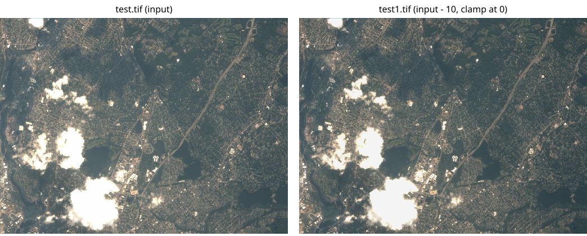
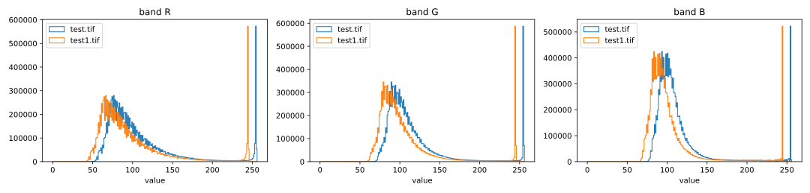

# 程序设计实践技能上机 D —— 图像读写（GDAL）

本目录是课程上机实践 **“图像读写”** 的完整实现与运行结果。全部环境都在一台 Linux（Debian 13，x86_64，8 核 CPU，无 GPU）机器上配置，实验也在这台机器上实际跑通。下面所有数字都来自真实运行日志（见 `results/`）。

本目录位于 `Changsr21/project-class` 仓库的 `image-rw-gdal-lab/` 下；源材料就在仓库根目录：`../程序设计实践技能上机D-图像读写.pptx`、`../ImageTest_VS2013_64.zip`（VS2013 + GDAL 2.0 示例工程）、`../test.tif.zip`（测试图像）。以下命令均在 `image-rw-gdal-lab/` 目录内执行。

## 1. PPT 要求与完成情况

PPT 只有 1 页，上机实践要求如下：

| PPT 要求 | 实现位置 | 完成情况 |
|---|---|---|
| 读取图像 `test.tif` | `src/ImageTest.cpp` → `Img_ReadFile()`（GDAL `RasterIO` 读取全部波段） | ✅ 读入 4096×3072、3 波段（RGB）、8 bit（Byte）、PackBits 压缩的 GeoTIFF |
| 将每个像素的灰度值减 10（若灰度值小于 0，则为 0） | `main()` 中三重循环（波段 × 行 × 列），`v = pixel - 10; if (v < 0) v = 0;` | ✅ 3 个波段的 37,748,736 个像素值逐一处理；独立校验 **0 处不一致** |
| 输出图像 `test1.tif` | `Img_WriteFile()`（GDAL GTiff 驱动，PackBits 压缩，与输入格式一致） | ✅ 生成 `output/test1.tif`（4096×3072×3，Byte，36,487,317 字节） |

> 说明：`test.tif` 是 RGB 三波段彩色图像，PPT 中的“灰度值”按惯例理解为**每个波段的像素值（DN 值）**，因此对 R、G、B 三个波段都执行“减 10、下限截断为 0”。

## 2. 目录结构

```
.
├── src/ImageTest.cpp        # 移植到 Linux 的主程序（实现 PPT 要求）
├── CMakeLists.txt           # CMake 构建脚本
├── run_all.sh               # 一键：编译 → 运行 → 校验 → 边界测试
├── scripts/verify.py        # 独立校验（GDAL Python 逐像素对比）+ 统计 + 出图
├── scripts/edge_test.py     # 边界测试（构造含 0~9 的 Byte / UInt16 图像，验证截断为 0）
├── environment.yml          # conda 环境（推荐）
├── requirements.txt         # 校验脚本的 Python 依赖
├── original/                # 课程原始 VS2013 工程源码（已由 GBK 转为 UTF-8，未改逻辑）
├── data/                    # 放 test.tif（未提交，见下文）
├── output/                  # 运行后生成 test1.tif（未提交，见下文）
└── results/                 # 运行日志、校验报告、对比图
```

## 3. 环境配置

原工程是 Windows + Visual Studio 2013 + GDAL 2.0（`gdal200.dll`）。本仓库改为跨平台的 CMake 工程，GDAL 使用 conda-forge 提供的版本。

实际使用的版本：g++ 16.2.0（conda-forge）、CMake 4.5.0、GDAL 3.13.3、Python 3.11.18、NumPy 2.4.6、Matplotlib 3.11.2。

```bash
# 1) 安装 micromamba / conda 后创建环境
micromamba create -f environment.yml      # 或：conda env create -f environment.yml
micromamba activate imgrw

# 2) 准备测试数据：解压仓库根目录的 test.tif.zip 到 data/
cd image-rw-gdal-lab   # 若尚未进入本目录
mkdir -p data && unzip -o ../test.tif.zip -d data/ && rm -rf data/__MACOSX   # 得到 data/test.tif
```

Windows 用户也可以直接使用 `original/` 中的 VS2013 工程，或者用 CMake + OSGeo4W / conda 版 GDAL 编译 `src/ImageTest.cpp`（代码里用 `#ifdef _WIN32` 兼容了 `_access`）。

## 4. 运行方法

```bash
bash run_all.sh                      # 默认：data/test.tif → output/test1.tif，减 10
# 或分步：
cmake -S . -B build -DCMAKE_BUILD_TYPE=Release && cmake --build build -j
./build/ImageTest data/test.tif output/test1.tif 10      # 参数：输入 输出 减去的值（都可省略）
python scripts/verify.py data/test.tif output/test1.tif 10 results
python scripts/edge_test.py build/ImageTest
```

## 5. 实验结果

### 5.1 主实验：test.tif → test1.tif（`results/run_log.txt`）

```
input : data/test.tif
size  : 4096 x 3072, bands = 3, bits/pixel = 8 (Byte)
output: output/test1.tif (each pixel value - 10, clamped to 0)
pixels clamped to 0: 0
time  : read 72.7 ms, process 101.3 ms, write 142.8 ms
```

### 5.2 独立校验（`results/verify_report.json`）

用 GDAL Python 重新读取输入和输出，逐像素检查 `test1 == max(test - 10, 0)`：

| 波段 | 输入 min / max / 均值 | 输出 min / max / 均值 | 均值差 |
|---|---|---|---|
| R | 30 / 255 / 109.7966 | 20 / 245 / 99.7966 | 10.0 |
| G | 48 / 255 / 116.4724 | 38 / 245 / 106.4724 | 10.0 |
| B | 50 / 255 / 114.1347 | 40 / 245 / 104.1347 | 10.0 |

- 像素值总数：37,748,736；**不一致：0** → **PASS**
- 输出尺寸、波段数、数据类型（Byte）、压缩方式（PACKBITS）都和输入一致
- 输出像素数据 MD5：`ce0ce7a2afb9435b37d216a88a860d06`（可用来核对复现结果）
- 注意：`test.tif` 的最小像素值是 30（R 波段），**没有小于 10 的像素**，所以主实验里“小于 0 置 0”的分支没有被触发。为验证这条规则，另外做了 5.3 的边界测试。

对比图（降采样显示）：



直方图（整体左移 10）：



### 5.3 边界测试（`results/edge_test_report.json`）

构造了 53×37、2 波段的随机图像，并且显式包含 0~11，用 `ImageTest` 处理后逐像素对比：

| 数据类型 | 像素值总数 | 其中 < 10（应截断为 0）的个数 | 程序报告截断数 | 不一致 | 结果 |
|---|---|---|---|---|---|
| Byte (8 bit) | 3,922 | 192 | 192 | 0 | PASS |
| UInt16 (16 bit) | 3,922 | 20 | 20 | 0 | PASS |

## 6. 相对原工程的修改与偏差说明

1. **平台移植**：`<io.h>/_access` → Linux 下用 `<unistd.h>/access`（通过 `#ifdef _WIN32` 兼容两种平台）；删掉了 VS 预编译头 `stdafx.h`；工程文件从 `.vcxproj` 改成 `CMakeLists.txt`。
2. **路径**：原代码把 `F:\\test.tif` 写死在程序里，现在改为命令行参数（默认 `test.tif` / `test1.tif` / 10）。
3. **实现 PPT 要求**：原 `main()` 只是把图像原样复制成 test1/test2；现在改为“每个像素值减 10，小于 0 则为 0”，结果输出为 `test1.tif`（不再生成 test2.tif）。
4. **Bug 修复**：
   - `Img_ReleaseDataBuf` 用 `delete` 释放 `new[]` 分配的内存（未定义行为）→ 改为 `delete[]`；
   - `Img_ReadFile` / `Img_WriteFile` 出错时直接返回，没有 `GDALClose` → 补上关闭；
   - 缓冲区大小用 `unsigned int` 相乘，大图像可能溢出 → 改为 `size_t`；
   - `Img_GetPixel` 通过强制转换 `unsigned short*` 读取（可能未对齐）→ 改用 `memcpy`；
   - 读取前检查数据类型，只支持 Byte / UInt16（和原 `Img_InitialDataBuf` 的支持范围一致）。
5. **遍历顺序**：原代码按“列外层、行内层”遍历，访存不连续；现在改为“行外层、列内层”，结果相同，速度更快。
6. **输出格式**：输出 GeoTIFF 时设置 `COMPRESS=PACKBITS`、`INTERLEAVE=PIXEL`，和输入保持一致（原代码不压缩）。
7. **GDAL 版本**：原工程用 GDAL 2.0（Windows DLL），这里用 GDAL 3.13.3（Linux）；用到的 API 两个版本都支持。
8. **没有缩减规模**：这次实验计算量很小（单次运行不到 0.5 秒），完整数据全量运行，没有做任何缩减。

## 7. 未提交到仓库的文件（以及怎么获得）

- `data/test.tif`（约 36.5 MB）：在仓库根目录的 `../test.tif.zip` 里，解压到 `data/`。
- `output/test1.tif`（约 36.5 MB）：运行 `bash run_all.sh` 就会重新生成，可以用上面的 MD5 `ce0ce7a2afb9435b37d216a88a860d06`（像素数据）核对。
- 原工程的编译产物（`x64/Debug`、`x64/Release` 下的 exe/dll/pdb 等）和 GDAL 头文件 `include/`：都是二进制或第三方文件，保留在仓库根目录的 `../ImageTest_VS2013_64.zip` 里，不重复提交。
- `results/*.png`：同内容的 SVG 版本已经提交（`results/compare.svg`、`results/histogram.svg`）。
